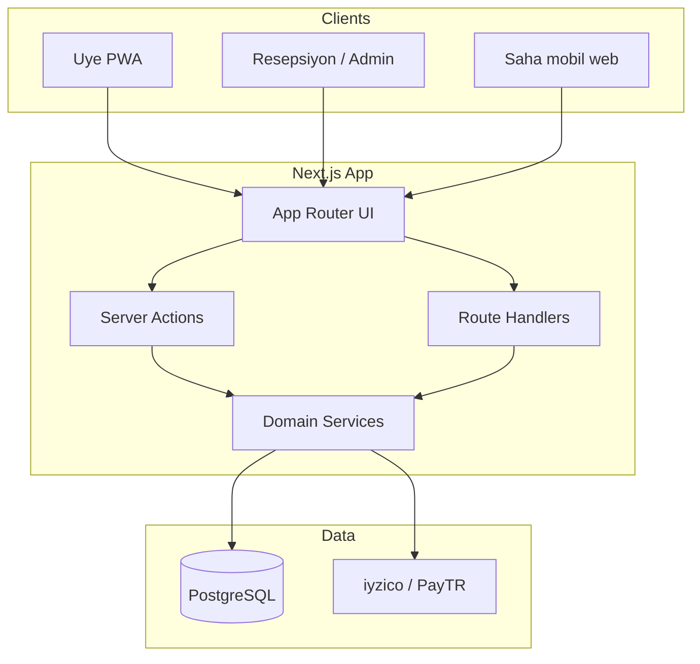

# TED Tenis Ops — Implementation Plan

**Referans:** [SPECIFICATION.md](./SPECIFICATION.md) v0.1  
**Versiyon:** 0.1  
**Karar özeti:** Spec yeterince net; önce mimari ve kural motoru. Wireframe, Faz 1 ekranları kodlanırken low-fi Figma veya uygulama içi prototype ile gider.

---

## 1. Hedef mimari

Monolit **web uygulaması**: responsive (üye + saha telefon), resepsiyon masaüstü ağırlıklı admin. Tek deploy, tek PostgreSQL veritabanı. `organization_id` tüm tenant-scoped tablolarda (TED için sabit tek satır).



**Neden bu stack:** Hızlı MVP, iyi auth/DB ekosistemi, TR ödeme entegrasyonu sunucu tarafında, 100+ üye için fazlasıyla yeterli.

| Katman | Seçim | Not |
|--------|--------|-----|
| Framework | **Next.js** (App Router, TypeScript) | SSR + API aynı repo |
| UI | **Tailwind CSS** + headless (Radix) | TED markası sonra |
| ORM | **Prisma** | Migration + tip güvenliği |
| DB | **PostgreSQL** | Supabase hosted veya Docker |
| Auth | **Supabase Auth** veya **NextAuth + Credentials** | E-posta/şifre MVP; OTP Faz 2 |
| Ödeme | **iyzico** (birincil aday) | 3DS, iptal/iade API |
| Job / cron | **Vercel Cron** veya `pg_cron` | Hold expire, akşam temizlik listesi |
| Export | **ExcelJS** | Muhasebe export |

---

## 2. Domain servisleri (kalp)

Business logic UI’da değil; test edilebilir servislerde.

### 2.1 `AvailabilityService`

**Girdi:** `courtId`, `slotStart` (UTC sakla, UI Istanbul), isteğe bağlı `forMemberId` (limit kontrolleri).

**Çıktı:** `available | blocked | booked | hold | not_bookable`

**Kontrol sırası:**

1. Kort `bookable === false` → `not_bookable`
2. Slot 07:00–22:00 grid dışı → red
3. `slotStart` > now + 72h → red (advance)
4. Aktif `calendar_block` overlap (akademi, kış, turnuva, bakım)
5. Aktif `fixed_court_occurrence` / recurring fix lock
6. Onaylı `booking` veya geçerli `slot_hold`
7. Üye haftalık 3 aktif (yalnızca create path)

**Mevsim modu:** Availability’yi etkilemez (fiyat için); isteğe bağlı admin “kort kapalı” mevsim flag’i `season_assignment` ile eklenebilir.

### 2.2 `PricingService`

**Girdi:** `courtId`, `slotStart`, `bookingType` (normal | fix), o anki `season_mode_id`, ışık kuralları.

**Çıktı:** `Money` breakdown + `price_snapshot` JSON (audit).

**Kural değerlendirme:** Tarife satırları öncelik sırası (spesifik kort > grup > wildcard). İlk eşleşen satır veya katmanlı toplam (base + light surcharge) — admin modelinde **base + modifiers** tercih edilir.

Admin **simülasyon** endpoint: “Bu kort / bu saat kaç TL?”

### 2.3 `BookingService`

- `createHold(courtId, slotStart, memberId)` → 15 dk TTL
- `confirmBooking(holdId, guests[], paymentIntent)` → transaction içinde:
  - advisory lock veya `SELECT ... FOR UPDATE` on court+slot
  - availability yeniden doğrula
  - booking insert + hold delete
- `cancelBooking(id, actor)` → 2 saat kuralı, ceza hesap, ödeme iadesi/kısmi

### 2.4 `FixedCourtService`

Durum makinesi: `requested → contract_signed → active → ended | cancelled`  
`active` olunca `fixed_court_schedule` (weekday + time + court) recurring exception üretir veya runtime expand (tercih: **runtime expand 12 hafta rolling** + cron genişletme — DB şişmesin).

### 2.5 `AuditService`

Append-only `audit_log`: admin override, manuel rez, tarife değişikliği, fix durum geçişi.

---

## 3. Veritabanı şeması (taslak)

Tüm tablolarda: `id` UUID, `organization_id` UUID, `created_at`, `updated_at`.

### 3.1 Çekirdek

```text
organizations
  id, name, timezone, settings_json

courts
  id, organization_id, group_code (enum), number, display_name,
  bookable, metadata_json

season_modes
  id, organization_id, code, name  -- admin tanımlı etiketler

season_assignments
  id, court_id, season_mode_id, valid_from, valid_to
  -- overlap aynı court için uygulama uyarısı

calendar_blocks
  id, court_id nullable, group_code nullable,  -- null = tüm tenis
  block_type enum, title, starts_at, ends_at,
  created_by, allow_member_booking false

bookings
  id, court_id, member_id, starts_at, ends_at,
  status enum (pending_payment, confirmed, cancelled, completed),
  booking_type enum (normal, admin_manual, override),
  price_snapshot_json, cancellation_fee_cents nullable,
  override_reason nullable

booking_guests
  id, booking_id, full_name, phone nullable

slot_holds
  id, court_id, member_id, starts_at, expires_at

payments
  id, booking_id nullable, fixed_contract_id nullable,
  amount_cents, channel enum (online, reception, room),
  status, provider_ref, recorded_by_user_id nullable
```

### 3.2 Tarife

```text
tariff_sets
  id, name, valid_from, valid_to, booking_type filter

tariff_rules
  id, tariff_set_id, priority int,
  court_id nullable, group_code nullable, season_mode_id nullable,
  time_from, time_to, days_of_week bitmask,
  light_surcharge_cents nullable, light_after_time nullable,
  amount_cents
```

### 3.3 Fix kort

```text
fixed_court_requests
  id, member_id, court_id, weekday, start_time, notes, status

fixed_court_contracts
  id, request_id, signed_at, active_from, active_to,
  payment_status, tariff_set_id or flat_fee_cents

-- Runtime: contract + weekday → bookings veya virtual blocks
```

### 3.4 CRM & auth

```text
members
  id, organization_id, membership_no unique, first_name, last_name,
  email, phone, status enum, notes

users
  id, member_id nullable, email, password_hash or auth_provider_id,
  role enum (member, reception, field, academy_admin, winter_admin,
              accounting, super_admin)
```

Supabase Auth kullanılırsa `users.id` = auth.users.id eşlemesi.

### 3.5 Operasyon

```text
evening_cleaning_runs
  id, date, generated_at

evening_cleaning_items
  id, run_id, court_id, used_today bool, completed_at nullable,
  completed_by_user_id nullable
```

Akşam cron: o gün `confirmed` booking olan distinct court → items.

### 3.6 Audit

```text
audit_logs
  id, actor_user_id, action, entity_type, entity_id,
  before_json, after_json, reason nullable
```

### 3.7 Indexler (kritik)

- `bookings (court_id, starts_at)` UNIQUE where status in (confirmed, pending_payment)
- `slot_holds (court_id, starts_at)` + TTL job
- `calendar_blocks (starts_at, ends_at)` + court/group
- `members (membership_no)`, `members (phone)`

---

## 4. API yüzeyi

Server Actions (form/mutation) + JSON Route Handlers (mobil/entegrasyon).

| Alan | Örnek | Yetki |
|------|--------|-------|
| `GET /api/availability` | courtGroup, date | member+ |
| `POST /api/bookings/hold` | courtId, slot | member |
| `POST /api/bookings/confirm` | holdId, guests | member |
| `POST /api/bookings/:id/cancel` | | member / admin |
| `POST /api/payments/iyzico/callback` | | public signed |
| `GET /api/admin/export/excel` | from, to | accounting, super_admin |
| `POST /api/admin/blocks` | | scoped admin |
| `POST /api/admin/bookings/manual` | reason required | reception, super_admin |
| `GET /api/ops/cleaning/today` | | field, admin |
| `PATCH /api/ops/cleaning/:itemId` | | field |

Internal: `POST /api/cron/expire-holds`, `POST /api/cron/evening-cleaning` (secret header).

---

## 5. Yetkilendirme (RBAC)

| Rol | Rezervasyon | Blok | Tarife | Fix | Override | Export |
|-----|-------------|------|--------|-----|----------|--------|
| member | own CRUD | — | — | request | — | — |
| reception | read all, manual book | — | — | — | — | — |
| field | — | — | — | — | — | — |
| academy_admin | — | akademi only | — | — | — | — |
| winter_admin | — | kış only | — | — | — | — |
| accounting | read payments | — | — | — | — | export |
| super_admin | * | * | * | * | * | * |

Middleware: route prefix `/admin`, `/ops`, `/app` (üye).

---

## 6. Ödeme akışı (online)

1. `confirmBooking` → `pending_payment`, tutar `price_snapshot`
2. Sunucu iyzico checkout form / API initialize
3. Callback → imza doğrula → `payments` + `booking.confirmed`
4. Callback fail / timeout → hold expire veya booking cancel (15 dk uyumlu)

**Resepsiyon:** `channel=reception|room`, `recorded_by`, booking doğrudan `confirmed`.

**Fix:** `fixed_court_contracts.payment_status` muhasebe işaretler; slot kilidi `signed_at` + `payment_status=paid` policy (SPEC: imza sonrası muhasebe — ikisi de `active` öncesi checklist).

---

## 7. Ekran haritası (wireframe yerine)

Uygulama sprint’inde her ekran için kabul kriteri SPEC user story’den türetilir.

### Üye (`/app`)

1. **Giriş / şifremi unuttum**
2. **Ana:** tarih seçici (max +3 gün), grup sekmesi (Balon / Kapalı / Merkez)
3. **Grid:** kort satır × saat sütun — yeşil müsait, gri blok, kırmızı dolu
4. **Rezervasyon özeti:** misafir listesi, fiyat kırılımı (ışık satırı)
5. **Ödeme:** iyzico redirect / embedded
6. **Rezervasyonlarım:** iptal butonu (2 saat uyarı modal)
7. **Fix talep formu**

### Admin (`/admin`)

1. Dashboard: bugün doluluk, bekleyen fix talepleri
2. Takvim (read-only genel + filtre)
3. Bloklar CRUD
4. Mevsim atamaları (timeline veya tablo)
5. Tarife setleri + kural editörü + simülasyon
6. Üyeler + CSV import
7. Fix sözleşmeleri
8. Manuel rezervasyon (reason zorunlu)
9. Audit log listesi

### Ops (`/ops`)

1. **Akşam temizlik:** checklist, büyük dokunmatik toggle

### Muhasebe

1. Tarih aralığı → Excel indir

---

## 8. Proje yapısı (repo)

```text
kortex/
  SPECIFICATION.md
  IMPLEMENTATION.md
  TASKS.md                 # sonraki adım
  apps/web/                # Next.js
    app/
      (auth)/
      app/                 # üye
      admin/
      ops/
      api/
    lib/
      domain/
        availability.ts
        pricing.ts
        booking.ts
      db/
    prisma/
      schema.prisma
  packages/                # opsiyonel; başta apps/web içinde lib yeter
```

Monorepo şart değil; MVP tek `apps/web` veya kök Next projesi.

---

## 9. Uygulama fazları (teknik)

### Faz 1 — Takvim doğru (≈4–6 hafta)

- Prisma schema + seed (13 kort + fitness)
- Auth + member role
- Availability + blocks + booking (hold/confirm) **ödeme mock**
- Admin: kort, blok, manuel rez audit
- Üye grid + haftalık 3 + 72h

**Done:** çift booking imkansız; SPEC §5 kuralları API testleri.

### Faz 2 — Para (≈3–4 hafta)

- Tariff engine + snapshot
- iyzico + webhook
- Reception payment UI
- İptal ceza (2 saat)

### Faz 3 — CRM + fix (≈3–4 hafta)

- Import CSV
- Fix request → contract → recurring lock
- Excel export

### Faz 4 — Ops + sertleştirme

- Evening cleaning cron
- Academy/winter scoped admin
- E-posta bildirimleri (onay, iptal, hatırlatma)

---

## 10. Test stratejisi

| Katman | Araç |
|--------|------|
| Domain | Vitest — availability, pricing, cancel penalty tablo-driven |
| API | integration test — Postgres test container veya sqlite yok (PG özellikleri) |
| E2E | Playwright — happy path rezervasyon (Faz 1 sonu) |

Kritik senaryolar:

- Aynı slot eşzamanlı hold → biri kazanır
- Blok overlap üye book red
- 4. aktif rezervasyon aynı hafta red
- İptal T-1h ceza uygulanır
- Turnuva bloğu + admin override audit düşer

---

## 11. Deploy ve ortamlar

| Ortam | Amaç |
|-------|------|
| `development` | Docker Postgres local |
| `staging` | TED pilot — birkaç admin + test üyeler |
| `production` | tedclub subdomain (ör. `tenis.tedclub.org.tr`) — DNS TED IT |

Secrets: ödeme API, cron secret, DB URL — Vercel env veya kulüp VPS.

**Yedekleme:** günlük PG snapshot; booking/financial 7 yıl retention policy (TED muhasebe ile teyit).

---

## 12. SPEC açık kararları → implementation default

| # | Default (değiştirilebilir) |
|---|----------------------------|
| Ödeme | iyzico; PayTR alternatif branch |
| Cezalı iptal | Önce `member_balance` borç; kart çekimi Faz 2b |
| Fix dijital imza | Hayır; admin `signed_at` tarih girer |
| Peak band | Tarife rules; seed boş, admin doldurur |
| Resepsiyon manuel | Ödeme `reception` → anında confirmed |
| OTP | Faz 2; MVP e-posta + şifre |

---

## 13. Wireframe ne zaman?

**Faz 1 sprint 0 (2–3 gün):** yalnızca üye grid + admin blok ekranı için kağıt/Figma — TED resepsiyon 30 dk review.  
Kod zaten responsive; erken pixel-perfect wireframe tüm admin tarife ekranları için erken.

---

**İlgili belgeler:** [TASKS.md](./TASKS.md), [docs/UI_DESIGN_PRINCIPLES.md](./docs/UI_DESIGN_PRINCIPLES.md), [docs/DATA_DICTIONARY.md](./docs/DATA_DICTIONARY.md), [docs/ROLES_AND_PERMISSIONS.md](./docs/ROLES_AND_PERMISSIONS.md), [README.md](./README.md).

*Sonraki dosya: [TASKS.md](./TASKS.md) — Faz 1 görev kırılımı ve sıralama.*
