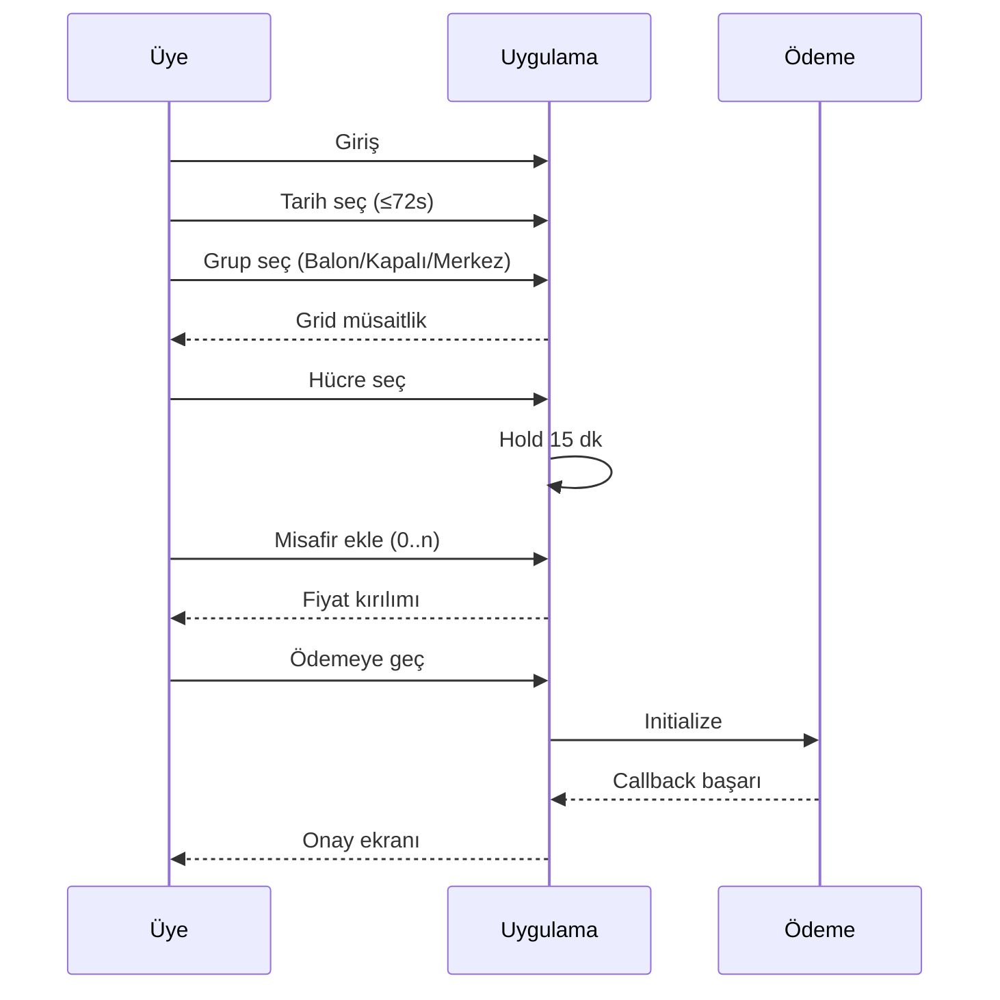

# TED Tenis Ops — User Flows

**Referans:** [SPECIFICATION.md](../SPECIFICATION.md)  
**Versiyon:** 0.1

---

## 1. Üye — normal rezervasyon (mutlu yol)

**Ön koşullar:** Aktif üye; haftalık aktif rez &lt; 3; slot bloklu değil.

**Alternatifler:**

- Hold süresi doldu → grid’e dön, slot yeniden kontrol
- Ödeme fail → rezervasyon pending veya iptal (IMPLEMENTATION default)
- Eşzamanlı alım → çakışma mesajı

---

## 2. Üye — iptal (ceza)

1. Rezervasyonlarım → satır seç  
2. “İptal et”  
3. Sistem `starts_at - now` hesaplar  
4. **≥ 2 saat:** onay → iptal, iade politikası  
5. **&lt; 2 saat:** modal ceza tutarı → “İptali onayla” → ceza kaydı + iptal  

---

## 3. Üye — fix kort talebi

1. Fix kort menüsü → form (kort grubu, gün, saat, not)  
2. Gönder → durum `requested`  
3. (Offline) sözleşme imza  
4. Muhasebe ödeme + admin `active`  
5. Üye bildirim (e-posta Faz 2) — ilgili slotlar artık grid’de dolu  

Üye fix slot için normal rezervasyon açamaz.

---

## 4. Resepsiyon — manuel rezervasyon

1. Admin/Resepsiyon giriş  
2. Takvim → “Manuel rezervasyon”  
3. Üye ara, kort, slot  
4. **Gerekçe** zorunlu  
5. Tahsilat: kasa/oda → anında `confirmed`  
6. Audit log yazılır  

Bypass: 72 saat / haftalık 3 — policy (super_admin tam bypass, reception kısıtlı — bkz. ROLES)

---

## 5. Admin — akademi bloku

1. Bloklar → Yeni  
2. Tip: Akademi  
3. Kort(lar) veya grup, tekrar (haftalık) veya tarih aralığı  
4. Kaydet → overlap uyarısı varsa onay  
5. Üye grid’de etiketli blok  

Akademi admin rolü yalnızca `block_type=academy` CRUD.

---

## 6. Admin — turnuva kapatma

1. Blok → Turnuva, Balon 1–9, tarih aralığı  
2. Üye rez kapalı  
3. İstisna: super_admin override tek slot + gerekçe  

---

## 7. Admin — mevsim (balon) geçişi

1. Mevsim atamaları → kort × `valid_from` / `valid_to` × mod  
2. Çakışan aralık uyarısı  
3. Tarife seti bağlantısı ayrı adım (fiyat değişimi)  

---

## 8. Muhasebe — Excel export

1. Rapor → tarih aralığı  
2. Filtre: kanal (online / resepsiyon / oda)  
3. İndir `.xlsx`  

---

## 9. Saha — akşam temizlik

1. `/ops` giriş  
2. Günün listesi (bugün booking olan kortlar)  
3. Her kort → “Temizlendi” toggle  
4. Opsiyonel: yönetim dashboard’da tamamlanmayanlar  

Cron otomatik liste üretir (IMPLEMENTATION).

---

## 10. Üye — import sonrası ilk giriş (Faz 3)

1. Admin CSV import  
2. Üye “Şifre oluştur” e-postası  
3. İlk giriş → profil doğrula → grid  

---

## 11. Hata akışları (özet)

| Kod | Kullanıcı mesajı |
|-----|------------------|
| WEEKLY_LIMIT | Bu hafta 3 aktif rezervasyon limitine ulaştınız. |
| ADVANCE_LIMIT | En fazla 3 gün sonrasına rezervasyon yapabilirsiniz. |
| SLOT_TAKEN | Bu saat az önce rezerve edildi. |
| BLOCKED | Bu saat kulüp programına ayrılmıştır. |
| NOT_BOOKABLE | Bu kort rezervasyona kapalıdır. |
| PAYMENT_FAILED | Ödeme tamamlanamadı. Tekrar deneyin veya resepsiyon. |

---

*Wireframe detayı: [UI_DESIGN_PRINCIPLES.md](./UI_DESIGN_PRINCIPLES.md) §4.*
