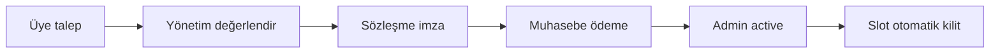

# Fix (Sabit) Kort Süreci

**Versiyon:** 1.0

---

## 1. Tanım

Üye belirli **gün + saat + kort** için dönemsel sabit hak. Fiyat saatlikten **farklı**. Ödeme **sözleşme imzası sonrası** muhasebe.

---

## 2. Akış özeti

---

## 3. Üye tarafı

1. Uygulama → Fix kort talebi  
2. Kort, haftanın günü, saat, not  
3. Durum: **Talep alındı**  
4. Bekle — kulüp arar / sözleşme  

Üye bu aşamada slot book edemez.

---

## 4. Yönetim

1. Talep listesi — onay/red  
2. Onay → sözleşme hazırlık (kağıt)  
3. Admin: `signed_at` gir  
4. Durum: **contract_signed**  

---

## 5. Muhasebe

1. Fix tarife tutarı tahsil  
2. Sistemde `payment_status = paid`  
3. super_admin **active** + `active_from` / `active_to`  

---

## 6. Sistem davranışı

`active` iken her matching weekday+time+court → availability FIXED_CONTRACT.  
Normal üye rez yok.

---

## 7. Erken fesih

Admin `cancelled` + bitiş tarihi. Gelecek slotlar açılır. İade kulüp policy — uygulama dışı.

---

## 8. Çakışmalar

- Turnuva bloku fix slotu overlap — turnuva öncelik (admin fix taşır)  
- Bakım — aynı  

---

## 9. Raporlama

Fix geliri ayrı export; saatlik rezervasyonla karışmaz.

---

*State machine: [../product/STATE_MACHINES.md](../product/STATE_MACHINES.md).*
