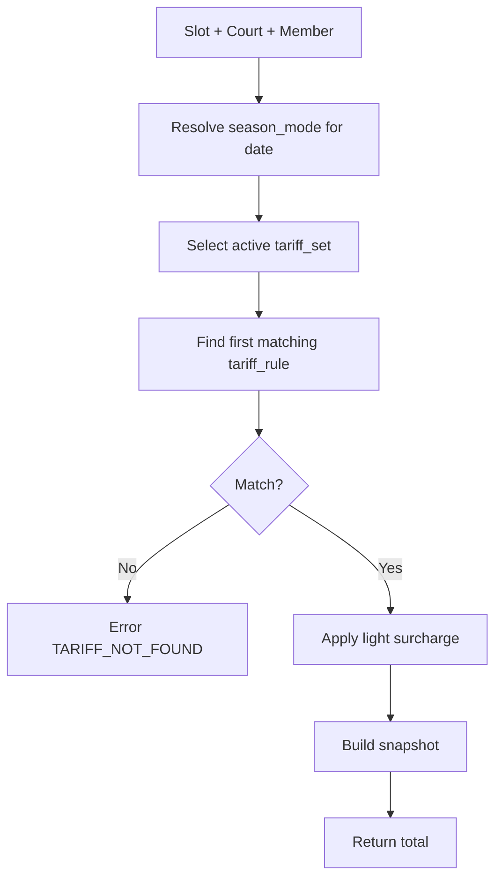

# Pricing Engine — Tarife Modeli ve Hesaplama

**Versiyon:** 1.0  
**Referans:** SPECIFICATION §6, DATA_DICTIONARY `tariff_*`

---

## 1. Amaç

Rezervasyon **confirm** anında tek doğru tutarı üretmek; `price_snapshot_json` olarak dondurmak. Geçmiş rezervasyonlar sonraki tarife değişikliklerinden etkilenmez.

---

## 2. Kapsam

| Rezervasyon tipi | Faz | Not |
|------------------|-----|-----|
| normal (üye saatlik) | 2 | Ana |
| admin_manual | 2 | Manuel tutar override (audit) |
| fix contract | 3 | Aylık/dönem; slot başı değil |
| override / turnuva satış | 2 | Admin girilen tutar |

Misafir **ayrı fiyatlandırma yok** — kulüp kuralı: misafir ücreti yok veya kort fiyatına dahil; TED’de üye öder, misafir sayısı fiyatı çoğaltmaz (varsayılan). **Değişirse:** `guest_multiplier` org setting.

---

## 3. Fiyat boyutları (TED)

1. **Kort kimliği** — Balon 1 ≠ Balon 9  
2. **Grup** — BALON, KAPALI, MERKEZ  
3. **Mevsim modu** — `season_mode` assignment o gün için court  
4. **Saat bandı** — örn. 07–17 off-peak, 17–22 peak  
5. **Işık** — admin: `light_after_time` (ör. 18:00) ve `light_surcharge_cents`; kort bazlı `has_lights` flag  
6. **Gün tipi** — hafta içi / hafta sonu (opsiyonel kural satırı)

---

## 4. Veri modeli

### 4.1 tariff_set

Dönemsel set; overlap admin uyarısı.

| Alan | Örnek |
|------|-------|
| name | Kış 2026 Balon |
| valid_from / valid_to | 2026-11-01 – 2027-03-31 |
| booking_type | normal |

### 4.2 tariff_rule (satırlar)

En spesifik kural kazanır — **priority** küçük = önce değerlendir.

```text
match(rule, ctx) =
  (rule.court_id IS NULL OR rule.court_id = ctx.court_id)
  AND (rule.group_code IS NULL OR rule.group_code = ctx.group_code)
  AND (rule.season_mode_id IS NULL OR rule.season_mode_id = ctx.season_mode_id)
  AND ctx.localTime in [rule.time_from, rule.time_to)
  AND ctx.dayOfWeek in rule.days_of_week
```

İlk eşleşen `amount_cents` = **base**.

### 4.3 Işık eklentisi

```text
if court.has_lights
   AND ctx.localTime >= org.light_after_time (or rule.light_after_time)
   AND rule.light_surcharge_cents > 0
then total = base + light_surcharge
```

Işık kararı tamamen admin parametreleri — SPEC §4.

---

## 5. price_snapshot_json şeması

```json
{
  "version": 1,
  "currency": "TRY",
  "calculated_at": "2026-10-12T16:00:00+03:00",
  "tariff_set_id": "uuid",
  "tariff_rule_id": "uuid",
  "breakdown": {
    "base_cents": 45000,
    "light_surcharge_cents": 5000,
    "discount_cents": 0,
    "total_cents": 50000
  },
  "labels": {
    "court": "Balon 3",
    "slot": "2026-10-14 18:00–19:00",
    "season_mode": "kis_balon_a"
  },
  "display_total": "500,00 ₺"
}
```

---

## 6. Hesaplama akışı



---

## 7. Admin simülasyon

`POST /api/admin/pricing/simulate`

Body: `court_id`, `starts_at`  
Response: snapshot + matched rule id (debug)

Resepsiyon telefonda “bu saat kaç para?” sorusu için.

---

## 8. Fix kort fiyatlandırması

Saatlik engine **kullanılmaz**.

- Sözleşme: `flat_fee_cents` dönemlik veya `installments` (Faz 3+)  
- Muhasebe `payment_status=paid` → aktivasyon  
- Snapshot fix ödemesinde `booking_type: fix_contract`

---

## 9. İptal cezası tutarı

Org setting:

```text
cancellation_fee_cents (default)
cancellation_fee_percent_of_snapshot (optional, min/max)
```

İptal anında `cancellation_fee_cents` booking kaydına yazılır; tahsil: [WEBHOOKS_PAYMENT.md](../technical/WEBHOOKS_PAYMENT.md).

---

## 10. Örnek tarife tablosu (placeholder — TED dolduracak)

| Grup | Kort | Mevsim | Saat | H.içi | Base (₺) | Işık (+₺) |
|------|------|--------|------|-------|----------|-----------|
| BALON | 1–3 | kis_balon_a | 07–17 | ✓ | TODO | TODO |
| BALON | 1–3 | kis_balon_a | 17–22 | ✓ | TODO | TODO |
| BALON | 4–9 | kis_balon_b | … | … | TODO | TODO |
| KAPALI | 1–3 | kapali | … | … | TODO | TODO |
| MERKEZ | 1 | yaz_acik | … | … | TODO | TODO |

Gerçek rakamlar import: `docs/technical/SEED_DATA.md` § tariffs.

---

## 11. Yuvarlama

- Tüm hesap **kuruş (cents)** integer  
- Gösterim: TR locale 2 ondalık  
- KDV dahil/hariç org setting `prices_include_vat` — fatura metni muhasebe ile teyit

---

## 12. Hata kodları

| Kod | Anlam |
|-----|-------|
| TARIFF_NOT_FOUND | Eşleşen kural yok |
| TARIFF_SET_GAP | Tarih için aktif set yok |
| SEASON_UNASSIGNED | Kort için mevsim atanmamış |

---

## 13. Kenar durumları

| Senaryo | Davranış |
|---------|----------|
| Gece yarısı sınırında slot | localTime kuralı |
| Mevsim geçiş günü | O günün 00:00 itibarı yeni assignment |
| Admin tarife değiştirir | Eski snapshot değişmez |
| 0 TL turnuva override | Admin manual amount |

---

*Availability: [AVAILABILITY_RULES.md](./AVAILABILITY_RULES.md).*
