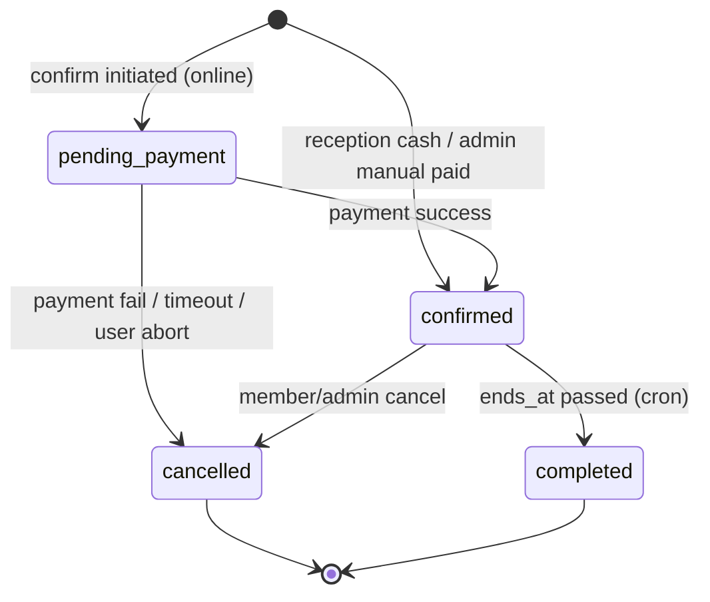
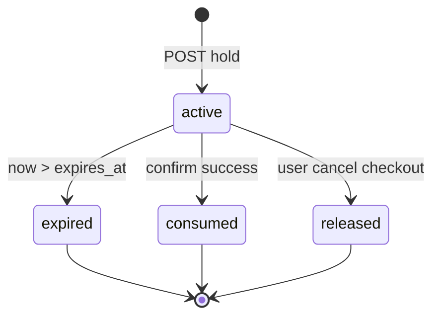
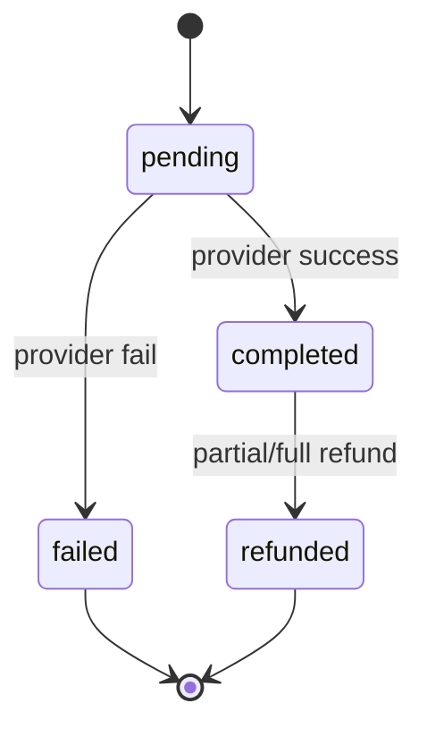
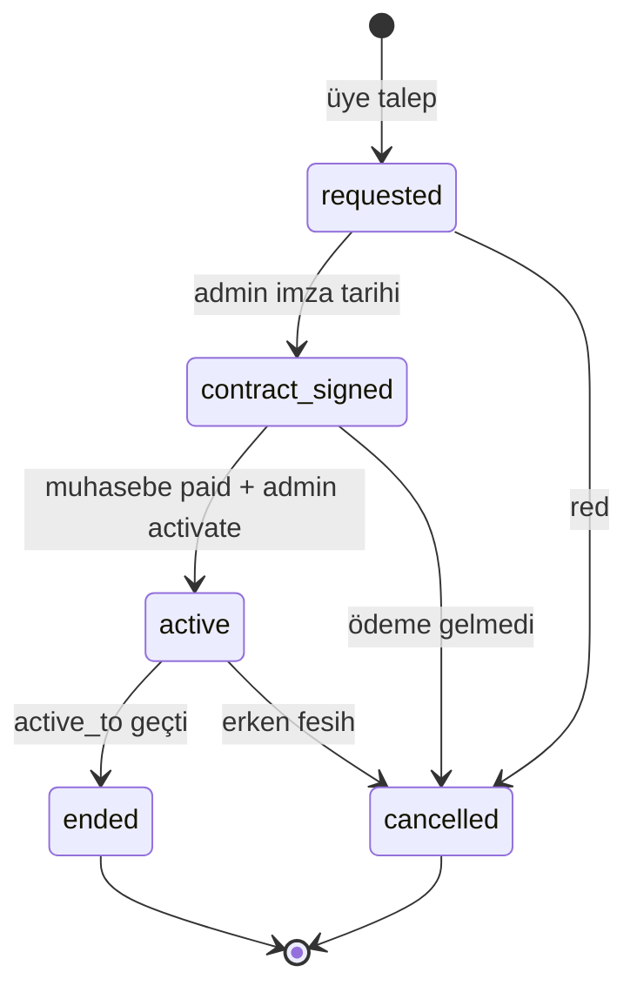
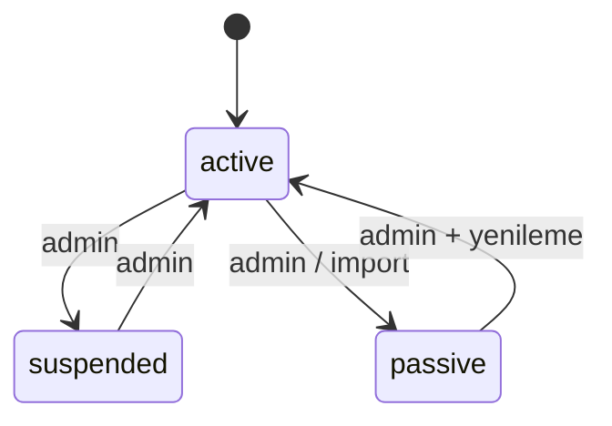
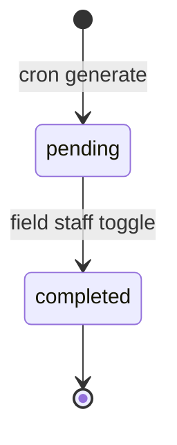

# Durum Makineleri (State Machines)

**Versiyon:** 1.0

---

## 1. Booking

### Geçiş kuralları

| From | To | Tetikleyici | Koşul |
|------|-----|-------------|-------|
| — | pending_payment | Üye ödemeye geç | hold valid |
| — | confirmed | Resepsiyon kayıt | reason if manual |
| pending_payment | confirmed | Webhook OK | amount = snapshot |
| pending_payment | cancelled | 15 dk timeout job | |
| confirmed | cancelled | İptal API | ceza hesap |
| confirmed | completed | Cron hourly | now > ends_at |

**pending_payment** slot’u bloklar (BOOKED sayılır availability’de).

---

## 2. Slot hold

TTL: 15 dakika (org setting `hold_minutes`).

---

## 3. Payment

Manuel kanal: doğrudan `completed` + `recorded_by_user_id`.

---

## 4. Fixed court contract

**active** → availability FIX lock.

---

## 5. Member status

---

## 6. Evening cleaning item

---

## 7. Calendar block

Statik — zaman aralığı; “durum” yok. **Soft delete** `deleted_at` (audit).

---

## 8. İptal ceza alt durumu (booking meta)

| cancellation_fee_status | Açıklama |
|-------------------------|----------|
| none | Erken iptal |
| assessed | Ceza hesaplandı |
| collected | Tahsil edildi |
| waived | Admin muaf |

---

*Hata kodları: [ERROR_CATALOG.md](./ERROR_CATALOG.md).*
