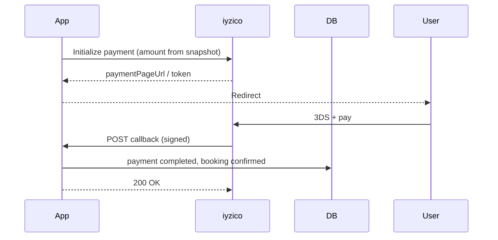

# Ödeme Webhook ve Mutabakat (iyzico)

**Versiyon:** 1.0  
**Sağlayıcı:** iyzico (birincil — ADR-005)

---

## 1. Akış



---

## 2. Tutar doğrulama

```text
callback.amount == booking.price_snapshot_json.breakdown.total_cents
```

Mismatch → log CRITICAL, booking pending, alert admin.

---

## 3. Idempotency

`provider_ref` unique index. Duplicate callback → 200 OK no-op.

---

## 4. Booking durumu

| Callback | Booking |
|----------|---------|
| success | confirmed |
| failure | cancelled (slot free) |
| user abort | cancelled |

---

## 5. İptal iade

Admin veya otomatik iptal (≥2h):

- Full refund API  
- Partial if cancellation_fee — fee retained, rest refund  

Refund webhook → `payment.status = refunded`, `refund_amount` log.

---

## 6. Ceza tahsil (Faz 2b)

Seçenek A: iptal modalında ek checkout  
Seçenek B: `member_balance_cents` borç — yeni rezervasyonda ek charge  

Default doc: **Seçenek B** — IMPLEMENTATION §12.

---

## 7. Resepsiyon / oda

Webhook yok. Staff POST payment → immediate completed.

---

## 8. Güvenlik

- Signature header verify (iyzico doc)  
- IP allowlist optional  
- Raw body log masked  

---

## 9. Reconciliation job (günlük)

- List pending_payment &gt; 30 min  
- iyzico inquiry API  
- Fix drift  

---

## 10. Test kartları

Sandbox iyzico — staging only. Prod kart staging’de yasak.

---

*Hata: [../product/ERROR_CATALOG.md](../product/ERROR_CATALOG.md).*
